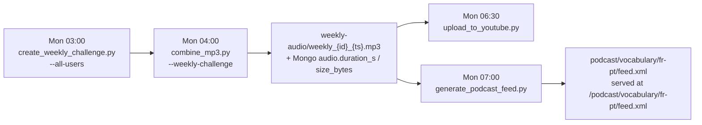

# Podcast RSS Feed

Publishes the weekly vocabulary lesson MP3 (the same audio that is uploaded to YouTube) as a
podcast, via a standard **RSS 2.0 + iTunes** feed consumed by Apple Podcasts, Spotify, YouTube
Music, Pocket Casts and any other podcast directory.

| | |
|---|---|
| Feed URL | `https://dialecthub.net/podcast/vocabulary/fr-pt/feed.xml` |
| Cover art | `https://dialecthub.net/podcast/fr-pt/cover.jpg` |
| Source audio | `https://dialecthub.net/weekly-audio/weekly_{docId}_{YYYYmmdd}_{HHmmss}.mp3` |
| Generator | `podcast/generate_podcast_feed.py` (weekly CronJob — one per language pair) |
| Show type | `episodic` (newest episode first) |
| URL scheme | `/podcast/{show}/{pair}/feed.xml` — `show` = `vocabulary`, `pair` = `{native}-{learning}` |

> ⚠️ **Each feed URL is permanent.** Once submitted to Apple/Spotify, changing it means creating a
> new show. Treat `https://dialecthub.net/podcast/vocabulary/fr-pt/feed.xml` as an API contract —
> the `{show}` and `{pair}` segments exist so a second pair or a second show gets its own URL
> without ever touching the first one.

## How It Works



1. The **global** lesson is the `weeklychallenges` document with `userId: null` (per-user lessons
   stay private — they are never published to YouTube or the podcast).
2. `combine_mp3.py` writes `weekly_{docId}_{YYYYmmdd}_{HHmmss}.mp3` into `/weekly-audio` and stores
   `audio.filename`, `audio.last_update`, `audio.duration_s` and `audio.size_bytes` in MongoDB.
3. `generate_podcast_feed.py` selects global lessons whose `weekStart >= --first-week`, resolves each
   MP3 (falling back to `stat`/`ffprobe` and backfilling Mongo when the metadata is missing), and
   writes `feed.xml` **atomically** (`feed.xml.tmp` → `os.replace`).
4. Express serves that directory at `/podcast` (`PODCAST_PATH` env var, default `/app/podcast`) with
   `Content-Type: application/rss+xml; charset=utf-8` and a 5-minute cache. The job writes to
   `<hostPath>/<show>/<pair>/`, so a single hostPath holds every show and pair.

Because the feed is regenerated weekly, it always reflects the current MongoDB state — there is no
incremental publishing step and no "publish" button.

## URL Layout

```
/podcast/{show}/{pair}/feed.xml     the RSS feed   (hostPath volume)
/podcast/{pair}/cover.jpg           show artwork   (ships with the app image)
```

- `{show}` — content type. Today `vocabulary`; a future *stories* or *verbs* podcast gets its own
  segment and therefore its own show entry.
- `{pair}` — `{native}-{learning}`, e.g. `fr-pt` (French speaker learning Portuguese) or, later,
  `en-pt`. Native **first**: do not read it as "Portuguese speaker learning French".
- Artwork is pair-scoped, not show-scoped, so every show for the same pair can share it.

## Feed Structure

Channel level (pair `fr-pt`):

- `title` — *DialectHub – Leçon de vocabulaire portugais européen*
- `itunes:author` / `itunes:owner` — DialectHub, `admin@dialecthub.net`
- `itunes:category` — `Education > Language Learning` (Apple requires these exact English names)
- `itunes:type` — `episodic` (`podcast.episodeType` in `values.yaml`)
- `itunes:explicit` — `false`, `language` — `fr`

Episode level:

| Element | Value |
|---|---|
| `title` | `Leçon de vocabulaire – Semaine du 26 octobre 2026` |
| `guid` (`isPermaLink="false"`) | the raw `weeklychallenges._id` — **must never change** |
| `pubDate` | RFC 822, parsed from the `YYYYmmdd_HHmmss` timestamp in the filename (UTC) |
| `enclosure` | `/weekly-audio/<filename>`, exact `length` in bytes, `type="audio/mpeg"` |
| `itunes:duration` | `M:SS` or `H:MM:SS`, from `audio.duration_s` or ffprobe |
| `itunes:episode` | stable sequence number stored as `podcast.episodeNumber` |
| `itunes:image` | the cover art URL |

Episode numbers are assigned **once** and persisted, so changing `--first-week` or skipping a week
never renumbers already-published episodes.

## Why some lessons are not in the feed

- **Per-user lessons** (documents with a `userId`) are excluded: they are built from each learner's
  weak words.
- **Lessons older than `podcast.firstWeek`** are excluded on purpose — the show does not backfill
  the archive that existed before podcasting was enabled.
- **Lessons whose MP3 is missing** are skipped with a warning in the CronJob log.

## Cover Art

Apple Podcasts and Spotify both require:

- Square, **1400 × 1400** to **3000 × 3000** pixels
- RGB, JPEG or PNG
- Under **512 KB**
- No transparency, no rounded corners, no explicit content

The cover is committed with the source and shipped with the web app, exactly like the favicons:

```
src/images/podcast/{pair}/cover.jpg    (source — commit this)
        │  webpack CopyPlugin
        ▼
public/podcast/{pair}/cover.jpg        (build output, served by Express)
        │
        ▼
https://dialecthub.net/podcast/{pair}/cover.jpg
```

- Add or replace `src/images/podcast/fr-pt/cover.jpg`, then rebuild (`npm run build`). The rule in
  `webpack.config.js` copies the whole `src/images/podcast/` tree, so adding `en-pt/cover.jpg`
  needs no config change. Nothing is copied to the node — updating artwork is a commit + image
  build + `helm upgrade`.
- The copy is `noErrorOnMissing`, so a build never fails before the artwork is added. Until the file
  exists the URL returns 404 and Apple/Spotify will reject that feed; the app logs
  `podcast cover art missing for <pair>` at startup (`PODCAST_PAIRS` env var lists the pairs to
  check).
- The generator does not validate the image (the CronJob cannot read `public/`). To check a
  committed file locally:
  `python3 podcast/generate_podcast_feed.py --pair fr-pt --cover src/images/podcast/fr-pt/cover.jpg …`

## Configuration

`helm/portuguese-learning/values.yaml`:

```yaml
podcast:
  hostPath: /home/ubuntu/PortugueseLearning/podcast
  show: vocabulary          # URL segment and directory: /podcast/vocabulary/fr-pt
  pairs: [fr-pt]            # one CronJob per pair; each needs its own cover art
  firstWeek: "2026-10-26"   # no earlier lesson is published
  baseUrl: ""               # empty → https://<ingress.host>
  audioBaseUrl: ""          # empty → same as baseUrl
  episodeType: episodic

podcastFeed:
  schedule: "0 7 * * 1"
  successfulJobsHistoryLimit: 3
  failedJobsHistoryLimit: 3
```

`audioBaseUrl` exists so the MP3 delivery host can be changed later (Cloudflare proxy, R2 bucket)
without touching code — see *Moving the audio to a CDN* below.

## Adding a language pair

1. Add the channel metadata in `podcast/generate_podcast_feed.py` → `SHOWS` (keyed by pair, e.g.
   `"en-pt"`), with the copy in the learner's language.
2. Add the artwork at `src/images/podcast/en-pt/cover.jpg` (3000×3000, under 512 KB).
3. Append the pair to `podcast.pairs` in `values.yaml`, commit, and let CI build the images.
4. Deploy. Helm renders one CronJob per pair: `<release>-podcast-feed-en-pt`.
5. Run it manually, validate the feed, then submit it as a **separate show** to Apple/Spotify.

> ⚠️ **Current limitation.** Every pair publishes the same global weekly lesson, because the feed
> reads `weeklychallenges` documents and those are now per-user; the generator no longer writes a
> `userId: null` document. Per-language audio *does* exist — `weeklychallenge_templates` holds one
> document (and one MP3) per `{weekStart, language}` — so the fix is to point the feed at the
> language-matched template for each pair. That migration is not part of this change.

## Deployment

### One-time: create the host directory

Both the Deployment and the CronJob mount the podcast directory with `hostPath: type: Directory`,
so it **must exist before `helm upgrade`** — otherwise the pod stays in `ContainerCreating` with a
`hostPath type check failed` event.

```bash
ssh ubuntu@<node>
sudo mkdir -p /home/ubuntu/PortugueseLearning/podcast
sudo chown 1000:1000 /home/ubuntu/PortugueseLearning/podcast   # the job runs as appuser (uid 1000)
```

Then deploy:

```bash
helm upgrade --install prod helm/portuguese-learning \
  --namespace portuguese-learning \
  --values helm/portuguese-learning/values-prod.yaml \
  --set image.app.tag=<version> \
  --set image.analytics.tag=<version>
```

### Run the generator immediately

The CronJob only fires on Monday 07:00. To publish now:

```bash
kubectl create job --from=cronjob/prod-podcast-feed-fr-pt -n portuguese-learning podcast-feed-manual-1
kubectl logs -n portuguese-learning job/podcast-feed-manual-1 -f
```

### Local run

Dependencies: `pymongo` and `ffprobe` (from `ffmpeg`). Neither needs to be declared for the
container — the shared analytics image already installs `pymongo` through
`weekly_challenge/requirements.txt` (and `vocal_lesson_creator/requirements.txt`) and ships
`ffmpeg`. For a local run: `pip install pymongo`.

```bash
# .env must provide MONGODB_URI
set -a && . ./.env && set +a

python3 podcast/generate_podcast_feed.py \
  --pair fr-pt \
  --show vocabulary \
  --audio-dir ./weekly-audio \
  --output-root /tmp/podcast \
  --first-week 2000-01-01 \
  --base-url https://dialecthub.net

xmllint --noout /tmp/podcast/vocabulary/fr-pt/feed.xml
```

`--dry-run` prints the XML to stdout without writing files or touching MongoDB.

### Unit tests

```bash
python3 -m unittest podcast/test_generate_podcast_feed.py -v
```

## Website page (`/podcasts`)

The same episodes are also published on the website at `https://dialecthub.net/podcasts`, free and
without an account.

| | |
|---|---|
| Page | `/podcasts` — `src/client/components/PodcastsPage.tsx`, public route in `src/client/App.tsx` |
| API | `GET /api/podcasts` — `src/routes/podcasts.ts`, no session, `Cache-Control: public, max-age=300` |
| Word list API | `GET /api/podcasts/:pair/episodes/:docId/words` |
| Data source | `episodes.json`, written by the **same** `generate_podcast_feed.py` run as `feed.xml` |

**Parity is structural, not synchronised.** The manifest and the feed are produced together from
the same query, so the page cannot drift from the RSS: whatever the job publishes is what the page
lists. When the job switches to `weeklychallenge_templates` (see [TODO](TODO.md)), the page follows
with no code change — it reads the manifest, not the database.

The API never queries MongoDB to list episodes, and it rewrites each enclosure URL to a relative
`/weekly-audio/<filename>` so the player and the `download` attribute work on any host (dev,
staging, production) without CORS.

### Word list (expandable)

`GET /api/podcasts/:pair/episodes/:docId/words` returns the vocabulary of one episode, but only if

- the `docId` appears in the published manifest for that pair, **and**
- the `weeklychallenges` document is a global lesson (`userId: null`).

Both checks form the allow-list that keeps private per-user lessons unreadable through a public
route — do not relax them.

### When the page is empty

The page renders *No episodes published yet* whenever `episodes.json` is missing, unreadable or an
empty array. In practice that means the feed job has not run yet (or produced no episode): the
manifest is only ever written by the CronJob, never by the app image. Check `feed.xml` first — if
that is missing too, the problem is in the job, not in the page.

`PODCAST_PAIRS` selects the tabs (fallback `fr-pt`) and `PODCAST_SHOW` (default `vocabulary`)
selects the directory; both are set on the app Deployment from `podcast.pairs` / `podcast.show`.

### Tests

`tests/podcasts.spec.ts` (Playwright, tagged `@smoke`) drives both the page and the API against
`tests/fixtures/podcast/vocabulary/fr-pt/episodes.json`, which `tests/start-mongo.js` exposes via
`PODCAST_PATH` in `.env.test` and whose lessons it seeds into the in-memory database.

## Submitting the show

Do this once, after the feed contains **at least one episode** and returns HTTP 200:

1. Verify the feed is publicly reachable and well formed:
   `curl -sI https://dialecthub.net/podcast/vocabulary/fr-pt/feed.xml` → `200`, `application/rss+xml`.
2. Validate with a cast-feed validator (e.g. Cast Feed Validator or Podcast Validator) — fix any
   errors before submitting. Most rejections are a missing `itunes:image` or a bad enclosure length.
3. **Apple Podcasts** — [Podcasts Connect](https://podcastsconnect.apple.com): *New Show* → paste
   the feed URL. Apple reviews manually (a few days).
4. **Spotify** — [Spotify for Creators](https://creators.spotify.com): *Add a podcast* → *Use an
   existing RSS feed*.
5. **YouTube Music / Amazon Music** — same RSS flow, separate submission.
6. Afterwards, platforms poll the feed on their own schedule (Spotify: hours; Apple: daily). New
   episodes appear with no further action.

There is **no API** for podcast submission: all of the above is manual UI work, once per platform.

## Moving the audio to a CDN later

Spotify and Apple stream from the `<enclosure>` URL on **every play** (unlike YouTube, which
downloads and rehosts). A 30 MB weekly episode served from the k3s node is fine for a small
audience; if traffic grows:

1. **Cloudflare in front of the apex** — all URLs stay identical, but the apex must then use a
   **DNS-01** challenge (the current HTTP-01 renewal breaks behind an orange-cloud proxy). This is
   the only option that keeps `dialecthub.net/weekly-audio/...` unchanged with zero feed edits.
2. **Different host** (e.g. `audio.dialecthub.net` on R2) — set `podcast.audioBaseUrl`, redeploy,
   and run the job: all `<enclosure>` URLs are rewritten in the feed while `guid`s stay stable, so
   directories update the episodes in place.

**Never delete MP3s that the feed references.** `/weekly-audio` currently has no retention, and it
must not get one without excluding the published episodes.

## Troubleshooting

| Symptom | Cause / fix |
|---|---|
| `permission denied` writing `/podcast` | Host directory not owned by uid 1000 — `sudo chown 1000:1000` |
| Pod stuck `ContainerCreating`, `hostPath type check failed` | Create the host directory before `helm upgrade` |
| Feed returns the React `index.html` | A route was registered after the `/{*path}` catch-all in `src/server.ts` |
| Feed has no `<item>` | No global lesson with `weekStart >= firstWeek`, or the MP3 was missing — check job logs |
| `/podcast/feed.xml` returns HTML | Expected: the feed moved to `/podcast/<show>/<pair>/feed.xml` |
| Apple rejects the feed | Missing/invalid cover art at `/podcast/<pair>/cover.jpg` (check `src/images/podcast/<pair>/cover.jpg` was committed and the client rebuilt), or the feed URL redirects (must be plain HTTPS 200) |
| Episode order looks wrong in Apple | `episodic` shows newest first by `pubDate`; verify the container clock is UTC |
| Numbering jumps after editing `firstWeek` | Expected for newly included lessons; existing episodes keep their numbers |
| `/podcasts` says "No episodes published yet" | `episodes.json` missing — run the feed job (`kubectl create job --from=cronjob/<release>-podcast-feed-fr-pt -n portuguese-learning <name>`) |
| Word list fails on `/podcasts` | The `weeklychallenges` document is gone, or it is a per-user lesson (only global `userId: null` lessons are exposed) |

## Related Documentation

- [Audio Generation](AUDIO_GENERATION.md) — how `sounds/*.mp3` are produced
- [Vocal Lesson Creator](VOCAL_LESSON_CREATOR.md) — the weekly MP3 builder
- [YouTube Uploader](YOUTUBE_UPLOADER.md) — the video counterpart of this pipeline
- [Deployment](DEPLOYMENT.md) — Helm, k3s and hostPath layout